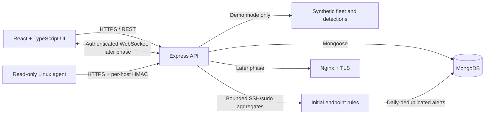

# SecureWatch

SecureWatch is a cybersecurity command center for authorized security-event monitoring, detection, alert triage, incident investigation, and reporting. Development uses synthetic events and systems you own or are explicitly authorized to monitor.

The project is being implemented incrementally. The current workspace includes a **simulated security dashboard and admin preview**, plus a **read-only Linux agent, authenticated telemetry intake, and initial endpoint detection rules**. Browser authentication, live report and alert browsing, alert workflows, and host-side actions are still planned work.

## Architecture

The initial system is a TypeScript modular monolith for the API and a separate React application. MongoDB stores application data. The API currently evaluates bounded SSH and sudo event aggregates from authenticated Linux agent reports; a separately deployable analysis engine may be added for richer correlation. Collectors and browser clients authenticate independently; server-side authorization controls all sensitive operations.



### Dependency choices

| Area | Choice | Use |
| --- | --- | --- |
| JavaScript runtime | Node.js 24 LTS, npm workspaces | One install and lockfile for the TypeScript packages |
| Web | React 19, TypeScript, Vite 8, MUI, Recharts | Responsive security dashboard and administrator workflow preview |
| API | Express 5, TypeScript, Zod, Helmet, CORS allowlist, express-rate-limit | Versioned REST API, demo workflows, HMAC-authenticated Linux agent intake, and request/security middleware |
| Data | MongoDB Community 8, Mongoose 9 | Document persistence and typed schemas as domain modules arrive |
| Detection | TypeScript rules in API; Python standard library agent | Initial SSH/sudo rules; configurable rule engine and richer correlation planned |
| Real time | `ws` on the API and browser WebSocket API | Authenticated updates in Phase 8 |
| Tests | Node test runner with `tsx`, Supertest; pytest later | Focused API tests, with additional suites added phase by phase |

The versions are semver ranges in package manifests. Run `npm install` once to create `package-lock.json`, review and commit that lockfile, then use `npm ci` for repeatable installs. MongoDB uses the 8.0 major line in local Compose and should receive patch updates.

## Repository layout

```text
securewatch/
├── agents/linux/                  # Read-only Python Linux inventory agent and systemd installer
├── apps/
│   ├── api/src/
│   │   ├── config/                 # Environment validation and MongoDB lifecycle
│   │   ├── middleware/             # Auth, validation, and RBAC (later phases)
│   │   ├── modules/                # Health now; auth, events, alerts, incidents, etc.
│   │   ├── shared/                 # Common API error handling
│   │   ├── websocket/              # Authenticated delivery (Phase 8)
│   │   ├── app.ts
│   │   └── server.ts
│   └── web/src/                    # React demo dashboard for endpoint and network signals
├── collectors/
│   ├── simulator/                  # Synthetic event generator (Phase 5/9)
│   └── ubuntu/                     # Opt-in authorized log collector (Phase 7)
├── detection/
│   ├── engine/
│   ├── rules/
│   └── tests/
├── docs/                           # Architecture and security notes
├── infra/
│   ├── docker/                     # Local MongoDB initialization
│   └── nginx/                      # Production reverse proxy (Phase 10)
├── tests/                          # Integration and security suites (later phases)
├── docker-compose.yml              # Local MongoDB Community service
├── .env.example
└── package.json                    # npm workspace root
```

## Phase status

- **Implemented:** npm workspace, TypeScript web and API packages, environment validation, MongoDB connection lifecycle, local authenticated MongoDB Compose service, API health endpoints, Helmet, CORS allowlist, JSON size limit, global rate limit, responsive security and administrator preview screens, and a read-only Python Linux agent. The live intake verifies per-agent HMAC signatures, timestamp freshness, and replay nonces, stores the latest host snapshot, and creates daily-deduplicated alerts for SSH authentication bursts and high sudo volume.
- **Demo mode:** with `DEMO_MODE=true`, the local API serves synthetic Linux, network, directory, account, and endpoint-file records and keeps changes in memory. It does not connect to MongoDB, an identity provider, Linux hosts, package managers, or networks. Approvals only change the preview request status; they do not execute endpoint actions. Evidence uploads are stored in API memory and cleared when the API restarts.
- **Planned:** authenticated users and enforced RBAC, live report and alert browsing in the dashboard, general event search, configurable detection rules, alert and incident workflows, WebSockets, durable administrative audit records, and deployment hardening. Remote host changes (user control, patch installation, and file quarantine) are not implemented; they require a trusted action protocol, constrained policy, and protected approval/audit workflows.

The dashboard and admin console remain local product previews, not live monitoring or identity-management services. The agent can send live snapshots and privacy-minimized security aggregates to the authenticated intake, but the dashboard still shows synthetic alerts and does not display stored live reports or alerts. The agent intake requires a TLS reverse proxy for remote clients; keep MongoDB private and do not expose the raw API listener.

## Ubuntu development setup

The commands below use Bash and an Ubuntu LTS system. Install Node 24 through nvm so you do not depend on an old Ubuntu package. The current Vite line requires a recent Node release; this repository sets the minimum to Node 22.12.

### 1. Base tools and Node.js

```bash
sudo apt update
sudo apt install -y git curl ca-certificates gnupg python3 python3-venv python3-pip openssl
curl -o- https://raw.githubusercontent.com/nvm-sh/nvm/v0.40.8/install.sh | bash
```

Open a new terminal, then run:

```bash
nvm install 24
nvm use 24
node --version
npm --version
git --version
python3 --version
```

Node 24 is the LTS line used for development. Node 22.12 or newer also meets the package engine requirement.

### 2. Configure environment and MongoDB

From the repository root:

```bash
cp .env.example .env
openssl rand -hex 32
openssl rand -hex 32
```

Put the first random value in `MONGO_INITDB_ROOT_PASSWORD`. Put the second in both `MONGO_APP_PASSWORD` and the password portion of `MONGODB_URI`. Keep the generated values private. The app user is restricted to `readWrite` on the `securewatch` database; the root account is used only for MongoDB initialization.

Install Docker Engine and the Compose plugin if needed, following the [official Ubuntu instructions](https://docs.docker.com/engine/install/ubuntu/). Start the database from the repository root:

```bash
docker compose up -d mongodb
docker compose ps
docker compose logs mongodb
```

The development database listens on host loopback only (`127.0.0.1:27017`). The MongoDB 8.0 Community image enables authentication and creates the restricted application user on the first initialization of the named data volume. Do not reuse this Compose setup as a production database deployment.

For a native MongoDB install, use the [MongoDB Community Edition Ubuntu instructions](https://www.mongodb.com/docs/manual/tutorial/install-mongodb-on-ubuntu/) for your exact Ubuntu LTS version. Enable MongoDB authorization and create a database-scoped `readWrite` user before setting `MONGODB_URI`; do not run the API against an unauthenticated service. The MongoDB 3.4 server that may be preinstalled on older machines is unsupported by this project.

#### Native MongoDB 8.0 installation (optional)

MongoDB's official 8.0 packages support Ubuntu 20.04, 22.04, and 24.04 LTS. The following commands show Ubuntu 24.04; for 22.04, substitute `jammy` for `noble`, and for 20.04 substitute `focal`.

```bash
sudo apt-get install -y gnupg curl
curl -fsSL https://pgp.mongodb.com/server-8.0.asc | sudo gpg -o /usr/share/keyrings/mongodb-server-8.0.gpg --dearmor
echo "deb [ arch=amd64,arm64 signed-by=/usr/share/keyrings/mongodb-server-8.0.gpg ] https://repo.mongodb.org/apt/ubuntu noble/mongodb-org/8.0 multiverse" | sudo tee /etc/apt/sources.list.d/mongodb-org-8.0.list
sudo apt-get update
sudo apt-get install -y mongodb-org
sudo systemctl enable --now mongod
sudo systemctl status mongod
```

Before enabling authentication, generate and copy an administrator password with `openssl rand -hex 32`. Keep it available for the next step, then create a MongoDB user-administration account without putting the password in shell history. These commands pass the password through an environment variable, which [mongosh scripts can read](https://www.mongodb.com/docs/mongodb-shell/write-scripts/env-variables/):

```bash
read -rsp "MongoDB administrator password: " SW_MONGO_ADMIN_PASSWORD; printf '\n'
export SW_MONGO_ADMIN_PASSWORD
mongosh --eval 'db.getSiblingDB("admin").createUser({ user: "securewatch_mongo_admin", pwd: process.env.SW_MONGO_ADMIN_PASSWORD, roles: [{ role: "userAdminAnyDatabase", db: "admin" }] })'
unset SW_MONGO_ADMIN_PASSWORD
```

Edit `/etc/mongod.conf` with `sudoedit`. Add `security: authorization: enabled` at the top level (merge it into an existing `security` section if present), save, then restart MongoDB:

```bash
sudo systemctl restart mongod
```

Generate and copy an application password with `openssl rand -hex 32`. Then create the restricted application user. `mongosh` prompts for the root password; the app password is read from the environment and does not appear in shell history:

```bash
read -rsp "App MongoDB password: " SW_MONGO_APP_PASSWORD; printf '\n'
export SW_MONGO_APP_PASSWORD
mongosh -u securewatch_mongo_admin --authenticationDatabase admin --password --eval 'db.getSiblingDB("securewatch").createUser({ user: "securewatch_app", pwd: process.env.SW_MONGO_APP_PASSWORD, roles: [{ role: "readWrite", db: "securewatch" }] })'
unset SW_MONGO_APP_PASSWORD
```

Set `MONGODB_URI=mongodb://securewatch_app:<APP_PASSWORD>@127.0.0.1:27017/securewatch?authSource=securewatch` in `.env`. A hexadecimal password needs no URI escaping. When using this native service, skip the Compose MongoDB startup command above. MongoDB binds to localhost by default; do not publish it to a public interface.

### 3. Install and start the API and web app

In the repository root, install the workspace dependencies. This creates the npm lockfile on the first install.

```bash
npm install
```

To preview the dashboard without starting MongoDB, run the API in simulated mode:

```bash
DEMO_MODE=true npm run dev:api
```

Then start the web app in a second terminal:

```bash
npm run dev:api
```

```bash
npm run dev:web
```

The preview API starts at `http://127.0.0.1:4000`; the dashboard runs at `http://127.0.0.1:5173`. Demo mode serves `GET /api/v1/dashboard/summary` with synthetic data and is rejected when `NODE_ENV=production`. For database-backed development, keep `DEMO_MODE=false`, configure MongoDB, then start the API normally.

### 4. Check the local API

In another terminal:

```bash
curl -i http://127.0.0.1:4000/api/v1/health/live
curl -i http://127.0.0.1:4000/api/v1/health
```

The liveness endpoint returns HTTP `200` with `{"success":true,"data":{"status":"alive"},...}`. Outside demo mode, the readiness endpoint returns HTTP `200` when MongoDB is available; otherwise it returns HTTP `503` with `database: disconnected`. Demo mode deliberately skips MongoDB, so readiness reports the database as disconnected while the dashboard preview endpoint remains available. Health responses do not expose database error details or credentials.

Run the API checks and type checks:

```bash
npm test
npm run typecheck
npm run build
```

The current API test suite covers liveness, database readiness, and structured unknown-route responses. Additional test suites will accompany real ingestion, detection, and workflow features.

## Security notes and current limitations

- The local MongoDB port and API listener bind to loopback. Keep them private while authentication and the deployment proxy are not yet implemented.
- The MongoDB application account has database-scoped `readWrite` permissions in Compose; the root account is initialization-only.
- Health responses reveal only whether MongoDB is reachable. Startup logs omit the raw database connection error and URI.
- CORS origins are explicit, JSON input is limited to 64 KiB, and Helmet and a rate limiter are active.
- Dashboard metrics and detections in demo mode are synthetic. No Linux host is contacted, no network scan is run, and no package changes are made.
- There is no user authentication, live alert query workflow, general event search, audit model, retention policy, or TLS termination yet. Do not use this preview as a production SOC deployment.
- Event data is treated as untrusted input. Current detections do not automatically block sources, disable accounts, install updates, or delete files.

The evolving threat model is in [docs/security.md](docs/security.md), and phase boundaries are in [docs/roadmap.md](docs/roadmap.md).
